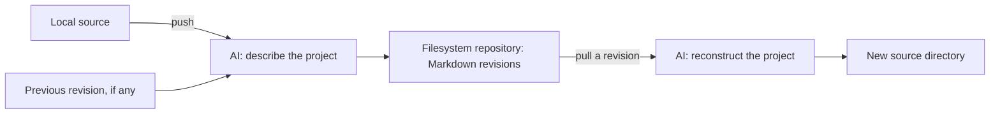

# GitVibe

### Yet another vibe-coded project. This one versions the vibes.

**Commit the intent. Pull a fresh implementation. Blame the model.**

You prompted an app into existence. You aren't entirely sure how it works. Naturally, the next step is to let another model remember it for you.

GitVibe is an experimental, intentionally lossy version control system: push your code, let an AI describe it, then pull a freshly generated implementation from that description. The knowledge repository keeps Markdown specifications. Your original working directory stays intact.

It's a game of telephone with your architecture. Now with revision IDs.

> **Experimental:** reconstruction is approximate and nondeterministic. The same revision can produce different code, dependencies, tests, and behavior. Keep exact source backups elsewhere. “It remembered the general idea” is the premise, not a recovery strategy.

## What does it actually do?

| You do this | GitVibe does this |
| --- | --- |
| `vgit --skill-issue init` | Creates `.vgit` inside the current project. |
| `vgit --skill-issue commit` | Describes supported source files as a new local knowledge revision. |
| `vgit --skill-issue status` | Shows changes in supported files since the last local commit. |
| `vgit --skill-issue export DEST` | Copies committed knowledge history to a separate filesystem repository. |
| `vgit --skill-issue push DEST` | Exports local commits; `push SOURCE --repo REPO` retains the legacy direct digest workflow. |
| `vgit --skill-issue rebuild` | Replaces an existing directory with a fresh implementation from a revision. |
| `vgit --skill-issue log` | Lists the revisions. Evidence that the vibes have evolved. |
| `vgit --skill-issue pull` | Asks a model to reconstruct a project from a saved specification, into a new directory. |
| `vgit --skill-issue login` / `vgit --skill-issue ssh-key` | Authenticates with the separate server and manages SSH public keys. |

Push captures a complete description of the current project, including changes and deletions. Each revision stands on its own, so you can also ask for an older version of the idea.

The server already supports persistent accounts, password and SSH key login, public/private repository metadata, and collaborator roles (`read`, `write`, `admin`, plus the owner).

**Current scope:** Push and log use filesystem paths, including mounted storage; pull also supports hosted revisions. The server manages accounts, repository permissions and knowledge revisions. Remote pull can fetch knowledge for local reconstruction or stream files generated by the server; remote source push remains to be implemented. Logging in won't teleport your local repository anywhere. That feature still requires code.

## Just tell it what to do

The default interface asks your configured model to select an action from your prompt:

```bash
vgit 'initialize /path/to/your/project'
vgit 'commit /path/to/your/project'
vgit 'export knowledge from /path/to/your/project to /tmp/my-vibes'
vgit 'show history of /tmp/my-vibes'
vgit 'pull /tmp/my-vibes to /tmp/regenerated-project'
vgit 'rebuild /path/to/project from /tmp/my-vibes'
```

You can also ask to log in or manage SSH keys; run `vgit --help` for examples. Configure a client model first, as shown below. The model is instructed to ask for missing details; its selection is validated before execution, but it can still misunderstand your intent. Prompts go to the configured provider, which may be remote. The default assistant replies like a medieval knight; set `GITVIBE_PROMPT_SYSTEM_PROMPT` to customize its style. Use `--skill-issue` when you need precise command arguments.

Prefer the old-fashioned interface? All explicit commands live under `vgit --skill-issue`; run `vgit --skill-issue --help` for the full list.

## Take it for a spin

Requires **Python 3.11+**. Both Python packages have **zero third-party runtime dependencies**. The model will be doing most of the waiting for us.

From the project root:

```bash
python -m pip install -e ./client
vgit --help
```

Start Ollama separately and download a model. Replace `YOUR_MODEL` below with its name; GitVibe does not start Ollama or download models for you.

```bash
export GITVIBE_AI_PROVIDER=ollama
export GITVIBE_AI_MODEL=YOUR_MODEL

cd /path/to/your/project
vgit --skill-issue init
vgit --skill-issue commit
vgit --skill-issue status
vgit --skill-issue log
vgit --skill-issue export /tmp/my-vibes
vgit --skill-issue pull /tmp/regenerated-project --repo /tmp/my-vibes
```

`commit` records a standalone knowledge revision in `.vgit`; `status` compares hashes of supported source files to the last local commit. Export copies all committed revisions to a new, empty, or compatible existing standalone repository; its optional outcome message uses the configured model. It refuses divergent history. For the original direct workflow, initialize a standalone repository with `vgit --skill-issue init --bare /tmp/my-vibes` and use `push SOURCE --repo /tmp/my-vibes`. Add `--revision REVISION_ID` to pull an older snapshot. Pass `--ai-command 'your adapter command'` on commit, push or pull to override the environment variable.

Prefer running directly from the checkout? Set `PYTHONPATH` and use `python -m vgit` in place of `vgit`:

```bash
export PYTHONPATH="/path/to/gitvibe/client/src"
python -m vgit --help
```

Built-in providers also support OpenAI and LM Studio, with configurable endpoints and credentials. See the [client guide](client/README.md#built-in-model-configuration) for settings. The bundled Ollama adapter remains available for custom adapter workflows.

GitVibe can also use a locally logged-in Codex CLI: set `GITVIBE_AI_PROVIDER=codex` and `GITVIBE_AI_MODEL` to your chosen model. Run `vgit --codex-dry-run` to inspect the launch without a model request, or prefix an operation with `vgit --codex-debug` to display launch details. See the [Codex provider guide](client/README.md#codex-cli-provider).

## Pull knowledge from a server

```bash
vgit --skill-issue pull /tmp/checkout --server http://127.0.0.1:7848 --repo alice/project
```

This fetches the latest hosted knowledge and reconstructs it using the client's configured model. Add `--revision REVISION_ID` for a specific revision, and set `GITVIBE_TOKEN` for private repositories. A repository writer can upload a specification through the [server API](server/README.md#knowledge-revisions). Add `--mode server` to stream generated files from the server instead; configure its model first. The client writes files to a temporary directory and publishes only after a complete stream.

## Rebuild an existing project

```bash
vgit --skill-issue rebuild /path/to/project --repo /tmp/my-vibes
# Optional: add --revision REVISION_ID or --ai-command 'your adapter command'.
```

Rebuild **replaces the entire target directory**, including hidden files and untracked files, with generated code. Keep any files you want to preserve elsewhere. The target must already exist and must be separate from the knowledge repository. Generation and validation finish before the target is moved; if the swap fails, GitVibe attempts to restore the original. A crash or cleanup failure can leave the original under a `.vgit-backup-*` directory beside the target. Review the generated code before running it. For a new directory, use pull instead.

## Architecture: a few moving parts, one very opinionated model

The working versioning flow lives in the client:



The client can call its built-in OpenAI, Ollama, or LM Studio provider, or invoke a custom model adapter as a subprocess using JSON over stdin/stdout.

Separately, the client's authentication commands talk to the server over HTTP(S). The server uses Python's `ThreadingHTTPServer` and SQLite to persist accounts, sessions, SSH public keys, repository metadata, and collaborator grants. Its database lives at `DATA_DIR/accounts.sqlite3`, separate from filesystem knowledge repositories.

SSH keys authenticate the HTTP API through signed challenges using OpenSSH `ssh-keygen`. There is no SSH daemon or SSH repository transport. Passwords use salted scrypt, and the database stores hashes of session tokens. See the [server documentation](server/README.md) for the API, permission rules, and authentication details.

### What a knowledge repository looks like

```text
my-vibes/
├── README.md
└── KNOWLEDGE/
    └── revisions/
        ├── 20261028T120000000000Z-a1b2c3d4.md
        └── 20261028T130000000000Z-e5f6a7b8.md
```

Each revision contains its parent ID and a complete prose specification. History is linear. Commit and push publish each revision atomically and use a temporary `KNOWLEDGE/LOCK.md` to prevent concurrent writers. Local `.vgit/status.json` stores file paths and hashes for status, not source snapshots. If a process crashes, inspect the repository before manually removing a stale lock. An interrupted export can leave a valid prefix of the history; rerun export to finish.

Markdown is the canonical storage format today. A vector index could come later. For now, you can read exactly what the model thinks your project does, and disagree with it in plain text.

### How this repo is organized

This repository contains the actual Python implementation. The Markdown-only idea applies to the knowledge repositories GitVibe creates.

```text
client/                         # Independently installable vgit-client package
├── pyproject.toml              # Installs the vgit command
├── src/vgit/
│   ├── cli.py                  # init, push, pull, log, validation and storage
│   ├── auth.py                 # HTTP login and SSH key management
│   └── ollama.py               # Bundled JSON model adapter
└── tests/                      # Workflow, adapter and authentication tests

server/                         # Independently installable vgit-server package
├── pyproject.toml              # Installs the vgit-server command
├── src/vgit_server/
│   ├── app.py                  # HTTP routing, validation and server startup
│   ├── store.py                # SQLite persistence and authorization
│   └── ssh.py                  # Public key validation and signature verification
└── tests/                      # Accounts, HTTP, permissions and SSH tests

local_context/
└── PROJECT_STATUS.md           # Development handoff and implementation status
```

There is no root Python package. Install the client and server separately, or together with `python -m pip install -e ./client -e ./server`.

## Run the server

```bash
python -m pip install -e ./server
vgit-server --host 127.0.0.1 --port 7848 --data-dir ./vgit-data
```

Without installing:

```bash
PYTHONPATH=server/src python -m vgit_server --port 7848
```

Keep the server data directory outside knowledge repositories and back it up separately. Use an HTTPS reverse proxy for remote credentials; loopback HTTP is supported for local development. SSH authentication additionally requires OpenSSH `ssh-keygen` with SSHSIG support on both client and server.

The [client guide](client/README.md) covers login and key management. The [server guide](server/README.md) covers account creation, repository metadata, collaborators, and the HTTP API.

## Bring your own model adapter

An adapter is an executable command, parsed **without a shell**, with a five-minute timeout. It reads one JSON object from stdin, writes one JSON object to stdout, sends diagnostics to stderr, and exits nonzero on failure. Only configure commands you trust.

For a push, GitVibe sends `operation: "digest"`, `instructions`, `files` (objects with `path` and `content` strings), and `previous_knowledge` (a string or null). The adapter returns:

```json
{"knowledge": "A standalone Markdown specification of the current project."}
```

For a pull, it sends `operation: "reconstruct"`, `instructions`, and `knowledge`. The adapter returns:

```json
{"files": [{"path": "src/main.py", "content": "print('a freshly manifested implementation')\n"}]}
```

Provider credentials belong in the adapter's environment, never in the knowledge repository. Source travels through stdin; GitVibe does not persist source snapshots there. Providers and adapters may retain prompts under their own policies.

## Messages from the court

Actions and errors get a short message generated by the configured model. The client prints its message to stderr while preserving command output and error details. Server API errors include a `vibe` field alongside the usual `error`. If a model is unavailable, built-in messages keep the court open. Set `GITVIBE_MESSAGE_SYSTEM_PROMPT` on either side to change its message style; see the [client guide](client/README.md#outcome-messages) and [server guide](server/README.md#outcome-messages).

## Fine print, because the vibes need boundaries

- **Source selection:** push reads an allowlist of common source extensions plus Markdown and TOML. It skips hidden paths, symlinks, common dependency/build directories, and unsupported formats. Requests and generated output are limited to 1,000 files and 2 MB; model context limits may be smaller.
- **Secrets:** filtering is not secret scanning. Secrets in ordinary source files can reach the model or appear in generated knowledge. Inspect the source you select, especially when using a remote provider.
- **Knowledge:** the model is instructed to return prose rather than source. Fenced code blocks are rejected, but GitVibe cannot prove the result contains no verbatim or encoded implementation.
- **Generated files:** pull rejects unsafe paths, duplicates, and file/directory collisions, refuses an existing output directory, and never executes generated code. Review the result before running it.

Remote source push, branching, merging, and vector storage are still unimplemented. Local reconstruction buffers the model response; server-mode pull streams complete file records into a staging directory.

## Tests: some things should be reproducible

Run both suites from the project root:

```bash
PYTHONPATH=client/src python -m unittest discover -s client/tests -v
PYTHONPATH=server/src python -m unittest discover -s server/tests -v
```

Client tests cover filesystem workflows, history, the adapter protocol, source filtering, authentication, and invalid model output. Server tests cover SQLite persistence, HTTP handling, permissions, sessions, and real SSH signatures. SSH tests require `ssh-keygen`.

Tests use controlled model responses and in-memory HTTP connections: no running model or listening server is required. They check the machinery, not whether a model can faithfully reconstruct your app. That part remains an experiment. Conveniently, so does the project.
